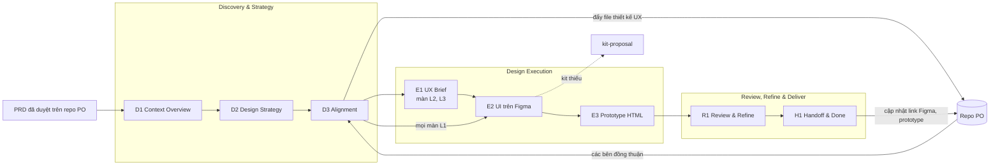

# UIUX-Workflow

Quy trình cho UI/UX Designer làm việc cùng AI, từ lúc PO có PRD đã duyệt tới lúc bàn giao thiết kế cho Dev. Designer đọc hiểu PRD cùng AI, đưa ra chiến lược thiết kế, đẩy lên repo của PO để các bên đồng thuận, sau đó mới thiết kế trên Figma và làm prototype HTML tương tác. AI đọc, phân tích, dựng, đo và soạn tài liệu; Designer quyết định ở các gate.

Repo kế thừa hướng dẫn cũ của team (`User Guide_UI-UX- Workflow w AI.md`), tham khảo khung engine và domain của PO-Workflow, và đối chiếu với phần thiết kế của AWS AI-DLC.

Trạng thái: engine v0.8, chưa gắn sản phẩm nào. Kiến thức nghề trong `engine/knowledge/` còn một phần ở dạng khung. Product KB được định nghĩa ở [DOMAIN-SETUP.md](DOMAIN-SETUP.md), điền khi chạy thật.

## Cài đặt

1. Cài Claude Code và đăng nhập (tiện ích trong VS Code, ứng dụng desktop, hoặc terminal).
2. Mở Claude Code ở thư mục bất kỳ, gửi: `Cài đặt UIUX-Workflow từ https://github.com/buidhui/uiux-workflow`. Sản phẩm đã có repo UIUX-Workflow riêng thì gửi link repo đó.

AI tải repo và hướng dẫn từng bước: kết nối Figma, nối repo của PO, kiểm tra. Các việc cần Designer tự thao tác (đăng nhập, bật tuỳ chọn trong Figma, xin quyền) và cách cài tay ở [USER-GUIDE.md](USER-GUIDE.md) Phần A.

Dành cho AI nhận yêu cầu cài đặt: tải repo về thư mục Designer chọn, đọc `engine/commands/setup.md` và làm theo từ bước 0.

## Tài liệu theo người đọc

| Tài liệu | Dành cho | Nội dung |
|---|---|---|
| [USER-GUIDE.md](USER-GUIDE.md) | Designer | Phần A: cài đặt, bốn cách kết nối Figma, repo của PO, repo sản phẩm. Phần B: từng bước một việc từ PRD tới bàn giao, tình huống ngoài luồng chuẩn |
| [DOMAIN-SETUP.md](DOMAIN-SETUP.md) | Người dựng Product KB | Mười một mục của Product KB, mức Tối thiểu và Hiệu quả |
| [GLOSSARY.md](GLOSSARY.md) | Mọi người | Thuật ngữ của quy trình |
| [AGENTS.md](AGENTS.md) | Mọi công cụ AI (Claude Code đọc qua `CLAUDE.md`) | Luật vận hành, cấu trúc chung và riêng, định tuyến lời nói, cách dùng với công cụ khác Claude Code |

Engine không phụ thuộc công cụ: chạy được với bốn cách kết nối Figma (kể cả không kết nối), với repo PO có quyền push, chỉ đọc, hoặc không có repo, và với công cụ AI khác Claude Code. Phần việc AI không làm được với một lựa chọn có cách thay thế ghi ở `USER-GUIDE.md` mục A3.

## Mục tiêu theo thứ tự

1. Theo SDLC hiện tại: đọc hiểu PRD của PO, đưa ra chiến lược thiết kế, đồng thuận với các bên.
2. Thiết kế trực tiếp lên Figma theo chiến lược đã đồng thuận, bằng UI kit của sản phẩm.
3. Đầu ra gồm thiết kế trên Figma và prototype HTML để thao tác thử luồng và state.
4. Sau đó: chạy theo AI-DLC (mục "Lộ trình AI-DLC").

UI kit của sản phẩm do người phụ trách kit dựng. Luồng này không dựng kit; gặp phần tử kit chưa có thì đề xuất bổ sung bằng `/kit-proposal`.

## Nguyên tắc nền

1. AI làm nhanh, Designer kiểm soát đúng. Không bỏ qua checkpoint, không bàn giao khi chưa đủ màn, state, checklist.
2. Hiểu trước, đồng thuận trước, vẽ sau. Chỉ vẽ lên Figma khi chiến lược đã được các bên đồng thuận.
3. Không phân tích lại nghiệp vụ, không sửa PRD. Khác biệt ghi thành ý kiến về PRD; điểm chưa rõ hỏi PO.
4. Bên ngoài chỉ tham gia ở cấp chiến lược (Alignment). Phần chi tiết do Designer quyết định; PO muốn xem thiết kế cuối thì xem trên Figma và prototype.
5. Độ sâu theo độ khó của từng màn: có sẵn component, cần mở rộng, hoặc cần sáng tạo.
6. Dùng những gì đã có: component của UI kit, pattern của app. Khi kit thiếu một phần tử, AI viết đề xuất bổ sung; AI không tự vẽ component.
7. AI không sửa thiết kế chính: chỉ ghi vào khu vực nháp, sau khi lưu version.
8. Kết quả phải đo được mới được xem là xong.

## Bức tranh chung



| Phase | Stage | Mục đích | Đầu ra | Gate |
|---|---|---|---|---|
| Discovery & Strategy | D1 Context Overview | Đọc hiểu PRD và bối cảnh; user task; câu hỏi | `context-overview.md` | Context checkpoint |
| | D2 Design Strategy | Flow, màn, bảy state, trường hợp biên, mức từng màn, ánh xạ UI kit, accessibility, ý kiến về PRD; flow prototype khi cần | `design-strategy.md`, `flow-map.md`, `flow-prototype.html` | Strategy Gate |
| | D3 Alignment | Đẩy chiến lược lên repo PO theo template của họ; chờ các bên đồng thuận; đồng bộ thay đổi | File thiết kế UX trên repo PO | Alignment Gate |
| Design Execution | E1 UX Brief & Wireframe | Màn L2: đề xuất component; màn L3: design ref, chọn hướng; bố cục, nội dung chữ | `ux-brief.md` | UX Brief Gate |
| | E2 UI Design | UI trên Figma bằng instance của UI kit, trong khu vực nháp; tự kiểm | Frame Figma, `build-report.md` | Không, sang E3 |
| | E3 Prototype | Prototype HTML thao tác được trọn luồng, đổi state, đổi vai | `index.html`, `prototype-report.md` | Không, sang R1 |
| Review, Refine & Deliver | R1 Review & Refine | Review độc lập; góp ý của BA, Dev; Dev feasibility; sửa Figma và prototype | `feedback.md`, `design-review.md` | UI Gate |
| | H1 Handoff & Done | Ghi chú bàn giao trên Figma; cập nhật file thiết kế UX trên repo PO; delivery summary | `delivery-summary.md` | Delivery Gate |

## Ghép với PO-Workflow

| PO-Workflow | UIUX-Workflow |
|---|---|
| 2.42 PRD được duyệt | `/new-intent`, D1 đọc PRD |
| 2.43 Design Alignment: PO tạo khung `inception/ux-design/ux-design.md` và giao Design PIC | D2 viết chiến lược; D3 render vào file đó, commit `design(<intent>): ux` |
| Decision Brief, các PIC ký | Alignment Gate chờ kết quả này |
| Story List lấy mã màn từ `ux-design.md` | H1 cập nhật cột Figma, link prototype trong `ux-design.md` |
| Thay đổi yêu cầu đi change request trên PRD | `/change-request` của UIUX, chạy lại D3 cho phần đổi |

Đường dẫn, template và quy ước cụ thể nằm ở Product KB mục 2, không ghi cứng trong engine.

## Mức thiết kế quyết định độ sâu

| Mức | Màn như thế nào | Đi thêm gì |
|---|---|---|
| L1 Có sẵn | Ghép từ component và pattern đã có | UX Brief nén vào chiến lược; AI dựng UI được |
| L2 Mở rộng | Thiếu component hoặc pattern | UX Brief có wireframe, đề xuất component, `/kit-proposal` |
| L3 Sáng tạo | Cần hướng thị giác hoặc trải nghiệm mới | Design ref bắt buộc, chọn một trong hai đến ba hướng, Designer dẫn UI |

Trục thứ hai là độ phức tạp logic. Chi tiết ở `engine/protocol/design-levels.md`. Số gate: CR màn có sẵn 4; có flow mới, mọi màn L1 là 5; có màn L2, L3 là 6.

## Prototype: HTML là đầu ra chính, Figma prototype là phụ

| | HTML | Figma prototype |
|---|---|---|
| Đổi state, đổi vai, dữ liệu rỗng hoặc lỗi | Có, bằng bảng điều khiển | Mỗi state một frame, nối tay |
| Logic theo rule (validate, rẽ nhánh) | Có | Rất hạn chế |
| Giống sản phẩm thật | Cao khi dùng đúng thư viện component frontend (Product KB mục 7) | Giống thiết kế, không giống hành vi |
| AI kiểm được | Chạy và chụp màn hình được | Ghi được tương tác, không chạy thử được |
| Rủi ro | Lệch với Figma nếu sửa một bên | Ít lệch |

Quyết định: E3 sinh prototype HTML một file từ frame Figma đã dựng, dùng thư viện component của frontend thật khi Product KB có, kèm bảng điều khiển vai, dữ liệu, state. Figma prototype chỉ nối điều hướng giữa frame theo flow chính khi Designer muốn trình bày trong Figma. Ngoài ra D2 có thể sinh flow prototype khung xám để các bên thao tác thử luồng trước buổi đồng thuận, với flow mới phức tạp. Chuẩn ở `engine/knowledge/prototyping.md`.

## AWS AI-DLC làm phần thiết kế như thế nào

Đối chiếu bản `awslabs/aidlc-workflows` đọc ngày 22/10/2026.

| | AWS AI-DLC | UIUX-Workflow |
|---|---|---|
| Ai làm | Design Agent (`aidlc-design-agent`): wireframe, interaction design, accessibility, design system compliance | Designer cùng AI |
| Khi nào | 1.6 Rough Mockups ở Ideation, sau Scope Definition: wireframe khung, user flow, IA, ghi chú accessibility mỗi màn. 2.5 Refined Mockups ở Inception, sau User Stories, trước Domain Design: mockup mid đến high fidelity theo từng story, interaction spec, design system mapping, responsive, accessibility checklist | Sau khi PRD được duyệt: D2 chiến lược, D3 đồng thuận, sau đó E1 đến H1 |
| Đầu ra | Toàn bộ là Markdown: `wireframes.md`, `user-flow.md`, `mockups.md`, `interaction-spec.md`, `design-system-mapping.md`, `accessibility-checklist.md`. Không có Figma, không có HTML | Chiến lược Markdown, UI trên Figma, prototype HTML |
| Duyệt | Product Lead review mang tính tham vấn, tối đa hai vòng; người duyệt ở gate | Strategy Gate do Designer; Alignment Gate do các bên; review độc lập ở R1 |
| Thiết kế và kỹ thuật | 2.6 Domain Design cần 2.5 xong trước: thiết kế đi trước thiết kế kỹ thuật | PO-Workflow cho ba team thiết kế song song từ PRD, gặp nhau ở Decision Brief |
| Chuẩn | WCAG 2.1 AA, vùng chạm 44 px, Nielsen 10, mẫu component spec | Dùng cùng các chuẩn; ngưỡng vùng chạm theo Product KB mục 9 |

`design-strategy.md` mục 1 đến 4 đã đặt theo bốn artifact của 2.5 Refined Mockups để sau này chuyển sang AI-DLC ít phải đổi.

## Lộ trình AI-DLC

Giai đoạn hiện tại theo SDLC: thiết kế bắt đầu từ PRD đã duyệt. Khi chuyển sang AI-DLC, thiết kế vào sớm hơn:

| AI-DLC | Việc của UIUX-Workflow | Ghi chú |
|---|---|---|
| 1.6 Rough Mockups, sau Scope Definition | Stage mới: wireframe khung và user flow từ intent và scope, trước khi có PRD; dùng lại flow prototype | Cần PO-Workflow chạy 1.6 hoặc mời Designer vào Ideation |
| 2.4 User Stories | Designer góp ý story ở mức giao diện | AWS chỉ bật chế độ cộng tác này ở scope enterprise |
| 2.5 Refined Mockups | D2 và D3 hiện tại, đầu vào đổi từ PRD sang user stories và requirements | Bốn mục đầu của chiến lược đã khớp artifact của AWS |
| Construction | E2, E3, R1, H1 hiện tại | Prototype HTML là phần thêm của UIUX-Workflow |

Trước khi đặt tên stage cho giai đoạn này, tra lại glossary và định nghĩa stage của AWS bản mới nhất, như PO-Workflow đã làm; không tự đặt thuật ngữ AWS.

## Lệnh

Designer không cần nhớ lệnh: nói tự nhiên, AI định tuyến theo bảng trong `AGENTS.md`.

| Lệnh | Việc |
|---|---|
| `/setup` | Cài đặt trên máy mới, kiểm lại hoặc đổi cách kết nối Figma |
| `/new-intent` | Tạo việc từ PRD đã duyệt, hỏi bù Product KB tối thiểu, chạy ngay D1 |
| `/ux` | Làm bước kế tiếp hoặc tiếp tục phần chưa hoàn tất |
| `/ux-status` | Trạng thái các việc, kiểm lệch với repo PO và Figma |
| `/ux-review` | Review độc lập chiến lược, hoặc `--shadow` cho màn đang chạy |
| `/change-request` | Chiến lược đã đồng thuận phải đổi |
| `/kit-proposal` | Đề xuất bổ sung component vào UI kit; chỉ đề xuất, không dựng |
| `/ds-lookup` | Tra luật design system và cách dùng kit |
| `/new-domain` | Dựng Product KB |

## Engine và Product KB

Engine không chứa dữ kiện sản phẩm. Repo chia ba phần, theo cùng cơ chế với PO-Workflow:

```
uiux-workflow/
├── AGENTS.md, CLAUDE.md, README.md, USER-GUIDE.md, GLOSSARY.md, DOMAIN-SETUP.md   chung
├── engine/            chung: stages/, commands/, protocol/, templates/ (gồm templates/domain/),
│                      verification/, knowledge/, agents/
├── .claude/           chung: lối tắt lệnh và agent cho Claude Code, trỏ vào engine/
├── domain/            riêng sản phẩm: Product KB (repo engine chỉ có README)
├── intents/           riêng sản phẩm: các việc thiết kế
├── adhoc/             riêng sản phẩm: việc một lượt, review shadow
├── memory/            riêng sản phẩm: bài học của team
└── .uiux/             riêng từng máy: trạng thái cài đặt, không đưa lên git
```

Lấy bản engine mới bằng `git pull engine main` chỉ đổi phần chung. Bảng đầy đủ ở `AGENTS.md` mục Cấu trúc.

Product KB ở `domain/`, manifest `domain.md` mười một mục, khung ở `engine/templates/domain/`, ưu tiên trỏ tới nguồn có sẵn (repo PO, thư mục dữ liệu UI kit, Figma). Định nghĩa, mức đầy đủ và cách cập nhật ở [DOMAIN-SETUP.md](DOMAIN-SETUP.md).

## Cấu trúc một intent

```
intents/<yymmdd-slug>/
├── intent.md          PRD và intent của PO, file Figma, prototype, design ref
├── state.md           màn và mức, stage, frame, version đã đẩy
├── decisions.md       quyết định, câu trả lời, rủi ro chấp nhận, CR
├── memory.md          quan sát, xét khi đóng intent
├── inputs/            tài liệu, wireframe của PO, ảnh màn cũ; inputs/refs/ cho design ref
├── discovery/         D1, D2, D3
├── execution/         E1, E2, E3 (prototype ở execution/prototype/)
├── delivery/          R1, H1
└── archive/           bản chụp D2, D3, E1, R1, H1 lúc duyệt
```

## Nguồn gốc

| Phần | Lấy từ |
|---|---|
| Ba phase, gate, bốn cách phản hồi, bảy state, feedback matrix, Dev feasibility | Hướng dẫn cũ của team |
| Chiến lược thiết kế đặt theo artifact của Refined Mockups; chuẩn UX, accessibility | AWS AI-DLC, `aidlc-design-agent` và stage 1.6, 2.5 |
| Điểm nhận và đẩy file thiết kế UX, Alignment | PO-Workflow, stage 2.43 |
| Discovery chi tiết, bản kê thay đổi, review chấm điểm, fix-prompt, luật thao tác Figma | Bộ skill VIC |
| Gap log, đề xuất bổ sung kit, không vẽ tay phần kit thiếu | Cách làm của bộ skill dựng kit (ví dụ `upbase-design-skills`) |
| Design ref, reference lock | `refero-design` |

## Việc còn lại

| # | Việc | Ghi chú |
|---|---|---|
| 1 | Chuyển nội dung còn lại vào `engine/knowledge/` | Có thể chép kiến thức của Design Agent AWS (MIT-0) cho heuristic, accessibility, interaction pattern |
| 2 | Kiểm các khả năng ghi "Kiểm khi cài" ở `USER-GUIDE.md` mục A3 trên một file thật: dựng instance, lưu version, đọc design context để sinh HTML | Ghi kết quả vào `.uiux/setup.md` |
| 3 | Chạy thử với một sản phẩm thật, dựng Product KB mức Tối thiểu | |
| 4 | Lộ trình AI-DLC | Sau khi luồng SDLC chạy ổn |
| 5 | Chạy thử `/setup` trên một máy chưa cài gì, với từng lựa chọn Figma | Lệnh mới ở v0.7, chưa chạy thử từ đầu tới cuối |

## Lịch sử

| Ngày | Thay đổi |
|---|---|
| 2026-10-13 | v0.1 đến v0.4: khung, rút nghi thức, mức thiết kế theo màn, tối ưu luồng |
| 2026-10-22 | v0.5: luồng theo SDLC bắt đầu từ PRD đã duyệt; D2 thành Design Strategy, thêm D3 Alignment đẩy chiến lược lên repo PO và chờ đồng thuận; thêm E3 Prototype HTML; bỏ dựng component, thay bằng `/kit-proposal`; Product KB mười một mục; đối chiếu và lộ trình AWS AI-DLC |
| 2026-10-22 | v0.6: thêm `SETUP.md` với bốn cách kết nối Figma, ba trường hợp repo PO, cách kiểm tra sau khi cài; thêm `AGENTS.md` cho công cụ AI khác; `figma-protocol.md` thêm mục Công cụ kết nối; agent UX Lead đọc được Figma qua mọi lựa chọn và làm việc được với ảnh; USER-GUIDE thêm tình huống ngoài luồng chuẩn; viết lại văn phong toàn bộ tài liệu theo dạng văn viết |
| 2026-10-22 | v0.7: gộp `SETUP.md` vào USER-GUIDE thành Phần A; thêm lệnh `/setup` tự cài đặt từ link repo và làm tiếp sau khi mở lại; trạng thái cài đặt và cách kết nối Figma của từng máy chuyển sang `.uiux/setup.md` (không đưa lên git), bỏ khỏi Product KB mục 6; repo sản phẩm dùng remote `engine` để lấy bản cập nhật engine |
| 2026-10-22 | v0.8: tách phần chung và phần riêng theo cơ chế của PO-Workflow. Engine chuyển từ `.claude/` sang `engine/` (`stages/` cho tám stage, `commands/` cho lệnh tiện ích); khung Product KB sang `engine/templates/domain/`; dữ liệu sản phẩm ở `domain/`, `intents/`, `adhoc/`, `memory/`; trạng thái cài đặt của máy ở `.uiux/`. `.claude/` chỉ còn lối tắt; bỏ lệnh riêng của từng stage, `/ux` là lối vào. Luật vận hành chuyển sang `AGENTS.md`, `CLAUDE.md` chỉ trỏ về. Nâng cấp repo sản phẩm tạo từ v0.7 trở về trước: chuyển dữ liệu ở `.claude/knowledge/domain/`, `.claude/intents/`, `.claude/adhoc/`, `.claude/memory/`, `.claude/local/` sang thư mục mới trước khi `git pull engine main` |
