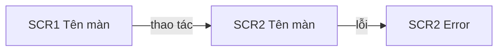

# Design Strategy: <tên tính năng>

Mục 1 đến 7 là phần đẩy lên repo của PO ở D3, render theo template của PO. Mục 8 trở đi là phần nội bộ của Designer. Các mục tương ứng artifact của stage 2.5 Refined Mockups trong AWS AI-DLC: danh sách màn và luồng (mockups), luồng và tương tác (interaction-spec), thành phần giao diện (design-system-mapping), accessibility (accessibility-checklist).

## 1. Danh sách màn
| SCR | Tên màn | Mới · Sửa · Mirror | User story | Vị trí trong app | Mức thiết kế | Figma |
|---|---|---|---|---|---|---|
| SCR1 | | | US1 | page · modal · drawer | L1 · L2 · L3 | <điền ở H1> |

## 2. Luồng và tương tác

Theo từng user story: điều hướng giữa các màn, hành vi khi thao tác, trạng thái rỗng, lỗi, đang tải, không có quyền. Màn hiển thị trạng thái của đối tượng khớp sơ đồ trạng thái trong PRD.

| SCR | Default | Empty | Loading | Success | Error | Disabled | Permission |
|---|---|---|---|---|---|---|---|

Trường hợp biên bắt buộc:
| EC | Màn | Tình huống | Cách giao diện xử lý |
|---|---|---|---|

Flow prototype: <link, nếu có>

## 3. Thành phần giao diện
| Vùng | Component của UI kit | Ghi chú |
|---|---|---|

Component kit chưa có:
| GAP | Cần gì | Màn | Xử lý tạm | Đề xuất bổ sung kit |
|---|---|---|---|---|

## 4. Accessibility
<Mức theo KB mục 9. Điểm cần lưu ý từng màn: tương phản, thao tác bằng bàn phím, nhãn cho trình đọc màn hình, cỡ chữ, vùng chạm.>

## 5. Màn cần sáng tạo
<Chỉ khi có màn L3. Vì sao cần khác biệt, cảm giác muốn tạo, design ref đã có hoặc cần có. Hướng thị giác chi tiết chọn ở E1.>

## 6. Ý kiến về PRD
| Mã | Lập trường | Nội dung | Lý do |
|---|---|---|---|
| | Đồng ý · Đề xuất sửa · Phản đối | | |

<Không có ý kiến thì một dòng: "Đồng ý với PRD bản <version>".>

## 7. Rủi ro và câu hỏi cần trả lời
| # | Nội dung | Cần ai trả lời | Chặn |
|---|---|---|---|

---

## 8. Bảng duyệt nội bộ
| # | Hạng mục | Quyết định | Loại | Duyệt |
|---|---|---|---|---|
| 1 | SCR1 | | Theo yêu cầu · Assumption · Ngoài yêu cầu gốc · Mức thiết kế · Ý kiến PRD · GAP | ☐ |

## 9. Đường đi của từng màn
| SCR | Mức | Logic | UX Brief | UI do ai dựng | Design ref | Review độc lập | Prototype |
|---|---|---|---|---|---|---|---|
| | L1 · L2 · L3 | Thường · Phức tạp | Nén · Đầy đủ | AI · Designer | Không cần · Đã có · Cần có | Tuỳ · Bắt buộc | Có · Không |

## 10. Bản kê thay đổi
<CR trên màn có sẵn. Một dòng một màn một thay đổi; "sửa tương tự" là dòng mirror riêng.>

| # | Màn (mã, node) | Loại | Thay đổi | Component | State bị ảnh hưởng | Trường hợp biên bắt buộc | Mức |
|---|---|---|---|---|---|---|---|

## 11. UX Brief nén
<Cho màn L1. Mỗi màn: component theo vùng và nội dung chữ thật, kèm chuỗi dài nhất.>

| SCR | Vùng | Component, variant | Nội dung chữ |
|---|---|---|---|

## 12. Ngoài phạm vi và Nice-to-have
| Hạng mục | Lý do | Đề xuất |
|---|---|---|

## 13. Assumptions & Open Questions
