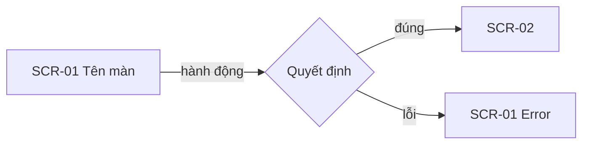

# Flow Map: <tên yêu cầu>

## 1. Flow
| FLOW | Tên | Mục tiêu | Vai | Loại | Ưu tiên | Truy vết |
|---|---|---|---|---|---|---|
| FLOW-01 | | | | Chính · Phụ · Lỗi | P1 · P2 · P3 | UT-01 |

## 2. Sơ đồ flow

FigJam: <link, nếu đã đẩy>

## 3. Chi tiết flow
### FLOW-01 <tên>
| Bước | Vai | Hành động | Phản hồi của hệ thống | Màn |
|---|---|---|---|---|

Nhánh và điều kiện:
- Nếu <điều kiện> thì <FLOW hoặc bước>

## 4. Danh sách màn
| SCR | Tên | Mới · Sửa · Mirror | Vị trí trong app | Flow | Node Figma | Mức thiết kế | Logic | Lý do gán mức |
|---|---|---|---|---|---|---|---|---|
| SCR-01 | | | page · modal · drawer · bottom sheet | FLOW-01 | | L1 · L2 · L3 | Thường · Phức tạp | |

## 5. State từng màn
Theo `engine/knowledge/screen-states.md`. Mỗi ô: có, không kèm lý do, hoặc GAP.

| SCR | Default | Empty | Loading | Success | Error | Disabled | Permission |
|---|---|---|---|---|---|---|---|

## 6. Trường hợp biên và permission
Độ sâu theo từng màn: rút gọn hoặc đầy đủ theo `design-levels.md`.

### Cấp flow (màn logic phức tạp)
| EC | Flow | Câu hỏi | Cách xử lý trên giao diện | Mức |
|---|---|---|---|---|

### Cấp màn
| EC | Màn | Nhóm | Tình huống | Cách xử lý trên giao diện | Nội dung đề xuất | Mức |
|---|---|---|---|---|---|---|
| EC-01 | SCR-01 | Nhập liệu · Quyền · Hệ thống và mạng · Giới hạn dữ liệu · Không hoàn tác | | | | Must · Should · Optional |

### Permission
| Vai | Màn hoặc phần tử | Thấy gì | Làm được gì | Thể hiện khi bị chặn |
|---|---|---|---|---|

### Đặc tả hành vi cho điểm phức tạp
| Điểm | Khởi động | Luật | Phản hồi | Lặp hoặc chế độ |
|---|---|---|---|---|

## 7. Ảnh hưởng lên màn hiện có
| SCR hiện có | Đổi gì | Vì sao |
|---|---|---|

## 8. UX pattern đề xuất
| SCR | Khung bố cục | Loại component chính | Pattern tham chiếu trong app |
|---|---|---|---|

## 9. Assumptions & Open Questions
